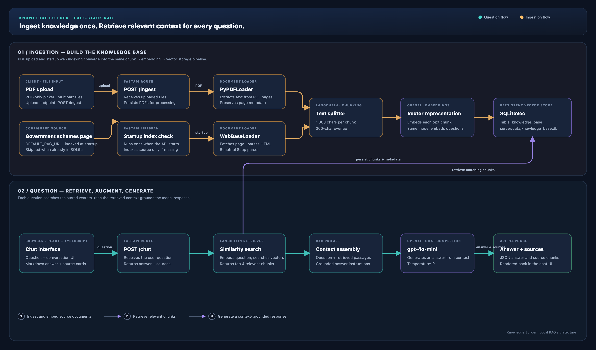
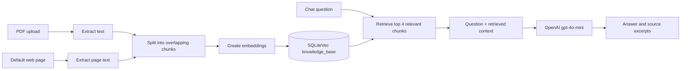

# Knowledge Builder

> A full-stack RAG app for chatting with your own PDF documents and a default web knowledge source.

Knowledge Builder lets you upload PDFs, ask questions in a chat interface, and see the source excerpts used to generate each answer. It also indexes a configurable web page—currently the Tamil Nadu government schemes page—when the API starts.

## Contents

- [What it does](#what-it-does)
- [Tech stack](#tech-stack)
- [Architecture](#architecture)
- [Run the app locally](#run-the-app-locally)
- [How RAG works](#how-rag-works)
- [API overview](#api-overview)
- [Troubleshooting](#troubleshooting)

## What it does

- Upload PDF documents through the web app.
- Ask questions in a chat-style interface.
- Retrieve relevant document passages and use them as context for an LLM answer.
- Display the retrieved passages as sources alongside the answer.
- Load a default web source into the knowledge base if that source has not already been indexed.

## Tech stack

| Area | Technologies |
| --- | --- |
| Frontend | React 19, TypeScript, Vite 8 |
| UI and Markdown | CSS, Lucide React, React Markdown, remark-gfm |
| Frontend API calls | Axios |
| Backend API | Python, FastAPI, Uvicorn |
| RAG pipeline | LangChain, OpenAI embeddings, `gpt-4o-mini` |
| Document loading | LangChain `PyPDFLoader` and `WebBaseLoader`, Beautiful Soup |
| Vector storage | SQLite, SQLiteVec |

## Architecture

The diagram below shows how documents move through ingestion and how a question becomes an answer grounded in retrieved context.



Want to explore the components? Open the standalone [interactive architecture diagram](./architecture.html) in a browser. It lets you highlight ingestion or question flows, select components for explanations, and export the diagram. GitHub displays the PNG preview directly; to use the interactive version, download `architecture.html` and open it locally, or publish it with GitHub Pages.

## Run the app locally

You will need **Node.js 20.19+ (or 22.12+)**, **Python 3.10+**, and an OpenAI API key with access to embeddings and chat completions. On the first server startup, the configured web source is fetched and embedded, so internet access is required.

### 1. Configure and start the server

Open a terminal in the project root and run:

```bash
cd server
python3 -m venv .venv
source .venv/bin/activate
python -m pip install -r requirements.txt
cp .env.example .env
```

On Windows PowerShell, create and activate the environment and copy the template like this:

```powershell
cd server
python -m venv .venv
.\.venv\Scripts\Activate.ps1
python -m pip install -r requirements.txt
Copy-Item .env.example .env
```

Edit `server/.env` and set `OPENAI_API_KEY` to your own key. The template also contains the default source URL and client origin. Never commit `.env` or put API keys in the frontend.

Start the API from the `server` directory:

```bash
python -m uvicorn app.main:app --reload
```

The API is at <http://127.0.0.1:8000>; interactive API docs are at <http://127.0.0.1:8000/docs>.

### 2. Start the client

In a **second terminal**, from the project root:

```bash
cd client
npm install
npm run dev
```

Open the Vite URL printed in the terminal (usually <http://localhost:5173>). The client uses `http://127.0.0.1:8000` as its default API URL.

To configure a different API URL, create `client/.env.local`:

```dotenv
VITE_API_URL=http://127.0.0.1:8000
```

`VITE_*` variables are included in the browser bundle; **do not store secrets in them**.

### Useful client commands

Run these from `client/`:

```bash
npm run build    # Type-check and create the production build
npm run lint     # Run ESLint
npm run preview  # Preview the production build locally
```

## How RAG works

**RAG** (retrieval-augmented generation) finds relevant passages from your knowledge base and gives those passages to the language model as context for its answer.



### Ingestion and storage

1. On startup, the server checks whether the configured `DEFAULT_RAG_URL` already has indexed chunks. If not, `WebBaseLoader` fetches the page and extracts its text.
2. PDF uploads are read with `PyPDFLoader`.
3. Extracted documents are split into chunks of up to **1,000 characters**, with **200 characters of overlap** between adjacent chunks.
4. LangChain creates embeddings and stores the chunks and metadata in the SQLiteVec table named `knowledge_base`.
5. The database is stored at `server/data/knowledge_base.db`. Uploaded PDF files are stored under `server/app/data/`.

The default source is skipped on later starts while its chunks remain in the database. Removing the database causes it to be indexed again on the next startup. Uploading PDFs requires the server's OpenAI credentials because indexing creates embeddings.

### Question answering and retrieval

1. The client sends a question to `POST /chat`.
2. The server embeds the question and searches the SQLiteVec index for the **four** most relevant chunks.
3. Those chunks are included in the prompt sent to `gpt-4o-mini`.
4. The API returns the answer and retrieved chunks. The client renders the answer as Markdown and displays source excerpts.

Answers are generated from retrieved context, but language-model responses can still be incomplete or incorrect. Check the returned sources for important information.

## API overview

| Method | Path | Purpose |
| --- | --- | --- |
| `GET` | `/` | Basic service message. |
| `POST` | `/ingest` | Upload one or more files using multipart form data with the field name `files`. |
| `POST` | `/chat` | Ask a question using a JSON body. |

Example chat request:

```json
{
  "question": "What schemes support farmers?"
}
```

The chat response includes an `answer` string and a `sources` array. The ingest response reports its status, message, and total number of indexed chunks.

## Troubleshooting

<details>
<summary>The server exits because an environment variable is missing</summary>

Make sure you created `server/.env` from `.env.example`, set `OPENAI_API_KEY`, and are starting Uvicorn from the `server/` directory.

</details>

<details>
<summary>The client cannot connect to the API</summary>

Confirm the server is running at `http://127.0.0.1:8000`. If you changed the API address, set `VITE_API_URL` in `client/.env.local` and restart Vite. Check that `CLIENT_URL` in `server/.env` matches the browser origin (by default, `http://localhost:5173`).

</details>

<details>
<summary>First startup takes longer than expected</summary>

The server indexes the default web page if it is not already in the SQLite database. This requires fetching the page and calling the OpenAI embeddings API. Check the server terminal for errors and confirm internet access and API credentials.

</details>
